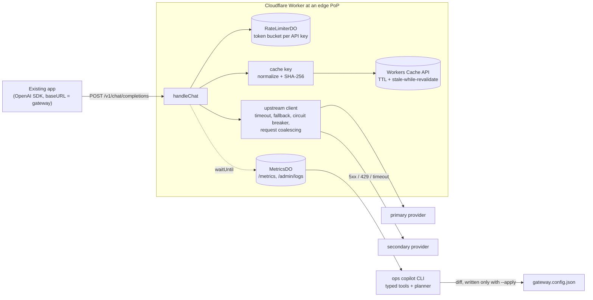

# edge-ai-gateway

An OpenAI-compatible LLM gateway that runs at the edge on Cloudflare Workers. An existing app changes one line, its `baseURL`, and gets CDN-style response caching, per-key rate limiting, multi-provider fallback with a circuit breaker, and structured observability. It also ships an **ops copilot**: a CLI built from typed, deterministic diagnostic tools plus a planner. The copilot reads the gateway's logs, explains incidents such as "why did the hit ratio drop?" and proposes a config fix as a diff. The fix is never applied without `--apply`. The copilot is scored by 12 scripted incident evals.

In a local benchmark against a simulated provider with 700 ms latency, the gateway did the following:

- served **84.8%** of 2,000 Zipf-distributed requests from cache;
- answered cache hits at **2.9 ms p50**, against **701 ms** for misses;
- avoided **86.6%** of upstream calls;
- kept success at **100%** under a 30% primary failure rate, against **69.2%** without fallback.

All of these are local runs against a simulated provider (details below).

## Architecture



The request path is `src/gateway.ts` (`handleChat`). It is a pure function of injected dependencies: cache, limiter, fetch, clock and log sink. `src/index.ts` wires it to the real Cache API and Durable Objects. The tests, the evals and the Worker all run the same handler.

## CDN concepts used here

| CDN concept | What it means here | Code |
|---|---|---|
| **Cache key** | A CDN builds the key from the normalized URL and ignores tracking params like `utm_*`. Here the key is SHA-256 over the model, the normalized messages (whitespace collapsed, case folded) and every other body field except a configurable ignore list (`user`, `request_id`, `metadata`). Keys are sorted, so JSON order doesn't matter. | `src/cacheKey.ts` |
| **TTL / `s-maxage`** | Entries are stored with `s-maxage = ttl + swr`. Responses carry `x-cache: HIT\|STALE\|MISS\|BYPASS` and an `age` header. | `cacheApiStore` in `src/index.ts`, `src/gateway.ts` |
| **Client `Cache-Control`** | `no-store` gives BYPASS (no read, no write). `no-cache` revalidates (skips the read and refreshes the entry). `max-age=N` refuses entries older than N seconds. | `parseCacheControl`, `decideCaching` |
| **stale-while-revalidate** | Inside the SWR window the stale entry is served immediately and a background refresh runs in `waitUntil`. | `src/gateway.ts` |
| **Edge PoPs** | The Workers Cache API is local to each data center, so every PoP warms its own cache. The rate limiter lives in a Durable Object, one per key and globally unique, so limits stay consistent across PoPs. | `src/index.ts` |
| **Origin shielding** | This covers only the request-collapsing half. Concurrent identical misses in one isolate share a single upstream call (50 requests were coalesced in the benchmark). There is no tiered cache: the Cache API doesn't support it. | `fetchAndStore` in `src/gateway.ts` |
| **Purge** | `POST /admin/purge {key}` deletes one entry at the current PoP only, which is the honest semantics of `cache.delete`. Bumping `cache.keyVersion` is the global "purge everything": old keys are never looked up again and expire on their own TTL. | `src/index.ts`, `src/cacheKey.ts` |
| **Origin failover** | On a timeout, 5xx or 429, the gateway retries on the next upstream. A consecutive-failure circuit breaker skips an unhealthy provider for a cooldown period. | `src/upstream.ts`, `src/circuitBreaker.ts` |

## Quickstart

Requires [Bun](https://bun.sh). Nothing here deploys, logs in, or calls a real model provider.

```bash
bun install
bun run test          # vitest: unit tests + integration tests inside workerd (local Cache API + Durable Objects)
                      # (`bun test` also works; it delegates to the vitest suite)
bun run typecheck

bunx wrangler dev     # gateway on http://127.0.0.1:8787 using in-process mock upstreams (mock://primary, mock://secondary)
curl -s -D - http://127.0.0.1:8787/v1/chat/completions -H 'authorization: Bearer my-app-key' \
  -d '{"model":"m","temperature":0,"messages":[{"role":"user","content":"What is a CDN?"}]}'
# run it twice: the second response has x-cache: HIT and an age header
curl -s http://127.0.0.1:8787/metrics

bun run bench         # starts the Bun mock upstream + wrangler dev itself; writes bench/results/*.json
bun run evals         # 12 incident scenarios + a 10-seed sweep; writes evals/results.json

# copilot on a simulated incident
bun run evals --emit timestamp_field_busts_cache --out incident.ndjson
bun run copilot "why did hit ratio drop?" --logs incident.ndjson --config incident.config.json
# copilot against a running gateway (reads /admin/logs), proposing changes to ./gateway.config.json
bun run copilot "anything wrong with the gateway?" --gateway http://127.0.0.1:8787
```

To point an existing OpenAI-SDK app at the gateway, set `baseURL: "http://127.0.0.1:8787/v1"`. The app's API key becomes its tenant identity: it is used for rate limiting and cache scoping, and it is only ever logged as a hash.

## Results

### Benchmark (`bench/results/cache.json`, `bench/results/fallback.json`)

> **Local runs against a simulated provider.** `wrangler dev` (workerd with its local Cache API and Durable Objects) and a Bun mock upstream ran on one Apple M4 laptop. The mock was set to 700 ms latency with ±10% jitter. These numbers show the mechanism working. They are not production latencies or real-provider numbers.

**Cache.** The run sent 2,000 requests. Prompts were drawn Zipf-distributed (s = 1.0) over 200 prompt templates, and 189 distinct templates were actually drawn. 20% of the requests carried cosmetic whitespace or case variants. All requests used temperature 0 and one tenant, at concurrency 16. The bench raises that tenant's rate limit to 100,000 (`RATE_LIMIT_CAPACITY`), so the limiter doesn't confound the cache measurement. Rate limiting is covered by the tests and evals instead.

| Metric | Value |
|---|---|
| Hit ratio (HIT / cacheable lookups) | **84.75%** (1,695 HIT, 305 MISS, 37 of the misses coalesced) |
| HIT latency, client-observed p50 / p95 | **2.9 ms / 7.7 ms** |
| MISS latency, client-observed p50 / p95 | **701 ms / 767.3 ms** |
| Upstream calls (counted at the mock) | **268 / 2,000** (189 distinct prompts; upper-case variants are separate keys because case folding is off by default) |
| Upstream calls avoided | **86.6%** |

**Fallback.** The cache was bypassed with `no-store`, so every request went upstream. The primary returned 503 on 30% of calls, and the secondary was healthy. Each mode ran 500 requests.

| Mode | Success rate | Status codes | p50 / p95 latency of successes |
|---|---|---|---|
| Fallback enabled | **100%** | 500 × 200 | 733 ms / 1,471.8 ms (failed primary + secondary ≈ 2 round trips) |
| Fallback disabled | **69.2%** | 346 × 200, 154 × 502 | 711 ms / 772 ms |

### Copilot evals (`evals/results.json`)

Each scenario generates about 3,000 log lines, or about 7,500 for the flood scenario. To generate them, synthetic traffic is replayed through the **real `handleChat`**: real cache keys, token bucket, fallback and breaker. The replay uses a virtual clock, a simulated provider and one injected root cause. The copilot then answers the scenario's question in deterministic mode. It is scored on two things: the root cause label, and whether the proposed fix changes the right config path with a valid value, or correctly proposes no config change when the cause lies outside the gateway.

| Scenario | Question asked | Expected root cause | Root cause | Fix |
|---|---|---|---|---|
| timestamp_field_busts_cache | Why did the cache hit ratio drop? | cache_key_field_busting | pass | pass: adds `timestamp` to `cache.ignoreFields` |
| uuid_field_busts_cache_half_tenants | Our LLM bill went up this afternoon. What changed? | cache_key_field_busting | pass | pass: adds `client_request_uuid` |
| ttl_misconfigured | Hit ratio fell right after this morning's deploy. Why? | ttl_too_short | pass | pass: `cache.ttlSeconds` 5 → 300 |
| primary_5xx_spike | Why is p95 latency up? | primary_provider_errors | pass | pass: drains primary (`upstreams.0.enabled` → false) |
| primary_timeout_too_tight | Why are so many requests hitting the secondary provider? | upstream_timeout_too_tight | pass | pass: `upstreams.0.timeoutMs` 1000 → 2500 |
| tenant_hammering | Customers are reporting 429s. Is the rate limiter broken? | rate_limit_hot_key | pass | pass: no config change (limiter working; contact tenant) |
| rate_limit_too_low | *(same question)* | rate_limit_too_low | pass | pass: `refillPerSecond` 0.2 → 1.4 and `capacity` 5 → 30 (the eval checks the refill rate) |
| client_no_store | Why did upstream calls jump? | client_no_store | pass | pass: no config change |
| temperature_bump | Why did the cache stop working for some clients? | nondeterministic_requests | pass | pass: no config change |
| novel_traffic | Why did the cache hit ratio drop? | novel_traffic | pass | pass: no config change |
| healthy_control | Anything wrong with the gateway today? | healthy | pass | pass: no config change |
| healthy_leading_question | Why did the cache hit ratio drop? | healthy | pass | pass: no config change |

The copilot got **12/12 root causes and 12/12 fixes.** A sweep re-ran every scenario with 10 extra traffic seeds, 120 runs in all, and it got **120/120** on both counts.

Read these numbers honestly. The same person wrote the scenarios and the diagnostic rules, so this is a regression suite that proves the tools and planner behave as designed. It is not an independent measure of diagnostic skill on real incidents. The simulator replays requests one at a time, so concurrency effects such as coalescing and breaker races are not exercised. The seed sweep varies only the traffic, not the incident parameters. The scenarios that guard against the obvious failure modes are: two scenarios with the same question but different causes (`tenant_hammering` vs `rate_limit_too_low`), a leading question on healthy traffic, a misleading question (`primary_5xx_spike` asks about latency), and the cases where the right answer is "no config change".

## Ops copilot

Run it with `bun run copilot "<question>"`.

- **Typed tools** (`copilot/tools.ts`) are pure functions over the log lines, each with a JSON input schema:
  - `cache_overview`
  - `hit_ratio_windows` (finds the change point)
  - `cache_key_cardinality` (per-field fan-out per repeated prompt, which finds the field that busts the cache)
  - `ttl_churn` (refetches of keys seen before vs the TTL)
  - `provider_health` (errors, timeouts and success latency vs the timeout, per provider)
  - `rate_limit_hot_keys`
- **The planner** (`copilot/planner.ts`) always runs a triage pass, so a misleading question can't hide the real cause. It drills into cache-key and TTL analysis only when the hit ratio moved or the question is about caching. It then ranks the findings by estimated impact on traffic.
- **Proposals** (`copilot/proposal.ts`) are restricted to an allowlist of tunable paths with range checks. They can't, for example, rewrite an upstream URL, disable every upstream, or add an output-affecting field such as `temperature` or `tools` to `cache.ignoreFields`, which would let different requests share a cache entry. The CLI prints a unified diff and writes `gateway.config.json` only with `--apply`.
- **LLM mode** (`--llm anthropic` uses `ANTHROPIC_API_KEY` and the official SDK; `--llm openai` uses `OPENAI_BASE_URL`, `OPENAI_API_KEY` and `OPENAI_MODEL` for any OpenAI-compatible endpoint). The model picks which typed tools to call and writes the diagnosis. Its proposed changes go through the same validator and the same `--apply` gate. **The default mode, the tests and every eval number above run deterministically with no API key. LLM mode has not been run against a real API in this repo.**

## Design decisions and tradeoffs

- **Only temperature-0 requests are cacheable by default.** A request with temperature > 0 asks for a sample, so a cached answer would quietly turn "varied output" into "the same output for everyone for 5 minutes". A missing temperature counts as the provider default of 1. Even at temperature 0, providers aren't bit-for-bit deterministic, so the cache makes repeated answers *more* consistent. That is usually what an app wants, and it is the cost of the hit ratio.
- **The cache key uses a denylist, not an allowlist.** Every body field is part of the key unless it is explicitly ignored. The cost is that a junk field (a timestamp, a UUID) busts the cache, which is exactly what the copilot's `cache_key_cardinality` tool catches. An allowlist would fail the other way: a new output-changing parameter (`response_format`, `tools`, a new provider flag) would be answered from an entry created without it. A wrong answer is worse than a miss.
- **Keys are scoped per tenant, with privacy in mind.** By default the hashed API key is part of the cache key, so tenant B can never receive tenant A's cached completion. B also can't infer from a fast HIT that someone else asked the same thing. `cache.scope: "global"` is opt-in, for public, non-sensitive prompts. Logs contain only hashes (key, prompt, per-field), never prompt text.
- **Case folding** (`cache.caseFold`) is **off by default**. Folding raises the hit ratio for chat-style prompts, but it can merge prompts where case changes the answer (code, acronyms), and a wrong answer is worse than a miss. Turn it on per deployment when prompts are case-insensitive.
- **The rate limit runs before the cache.** Cached responses still count against a key's bucket. This protects the gateway itself, not just the provider, at the cost of one Durable Object round trip on every request.
- **The circuit breaker counts consecutive failures, per isolate.** It is simple and cheap. The copilot's own evidence shows its weakness: with errors interleaved with successes (40% 5xx), it trips only intermittently. A failure-rate window, or breaker state shared through a Durable Object, would fix that.
- **What semantic caching would add, and the risk.** Embedding-similarity lookup would catch paraphrases that exact-match keys miss. The risk is a false hit: "cancel my order" and "don't cancel my order" embed close together, and the gateway would confidently serve the wrong answer. It would need conservative thresholds, per-tenant scope, an eval set of near-miss pairs, and probably opt-in per route. It is listed as a next step, not built.

## Limitations and next steps

- **No streaming.** `stream: true` returns a 400. Next step: cache the assembled stream and replay it as SSE.
- **API keys are not validated.** Any bearer token is accepted as a tenant identity. That also means a client can dodge its rate limit by minting new keys, since each new key gets a fresh bucket, so the per-key limit only means something once keys are checked. A real deployment would check keys against KV or D1 and hold the provider keys as Worker secrets (`apiKeyEnv` per upstream is wired but unused).
- **The model name is passed through unchanged.** Failing over between real providers that use different model names would need a per-upstream model map.
- **Cache and state are local.** The Cache API is per-PoP with no tiered cache. Breaker state and request coalescing are per isolate. Metrics live in one global, in-memory Durable Object that resets on eviction and becomes a hotspot at scale. The next step is Workers Analytics Engine or Logpush.
- **The admin endpoints are unauthenticated.** `/metrics` and `/admin/*` need a token or a separate admin Worker. Putting this Worker behind Cloudflare Access is not an option, because the Cache API is not available on Access-fronted Workers. When deployed, the Cache API also needs a custom domain; it does not work in dashboard previews.
- **The benchmark and evals are local and synthetic** (see the caveats above). The project is not deployed.
- **Next steps:** semantic cache (behind evals), per-route cache policies, a failure-rate breaker, KV-backed key management, and token-cost accounting per tenant.

## Layout

```
src/            Worker: gateway handler, cache key, token bucket, breaker, fallback, metrics, mock upstream
mock-upstream/  Bun server simulating two OpenAI-compatible providers (latency, failure rate, call counters)
copilot/        typed tools, planner, proposal validator/diff, optional LLM backends, CLI
evals/          scenario files, simulator (real handler + virtual clock), runner, results.json
bench/          benchmark driver and raw results
test/           unit tests (node) and Workers-runtime integration tests (vitest pool for workerd)
```

## How this was built

Designed by Roshan Silva and built with AI coding assistants (Claude Code). The tests, evals and benchmarks were all run locally, and every number above comes from the committed result files.

License: MIT.
